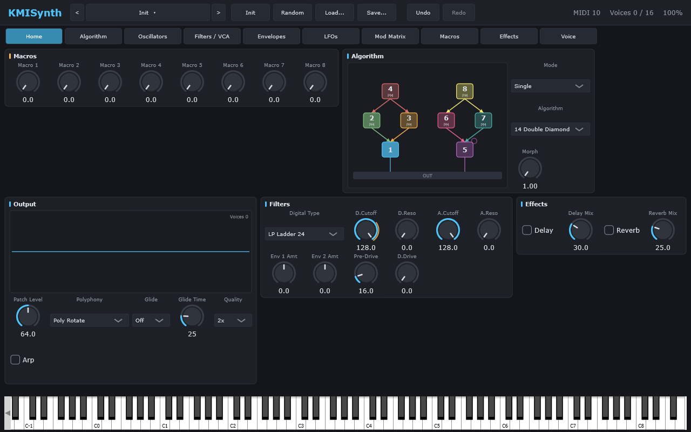
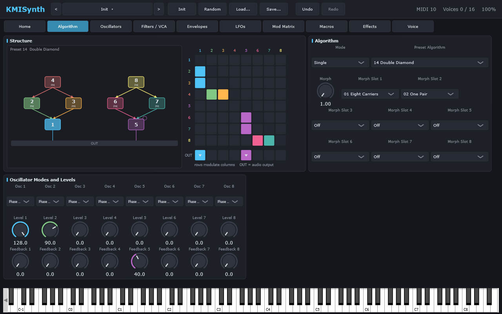
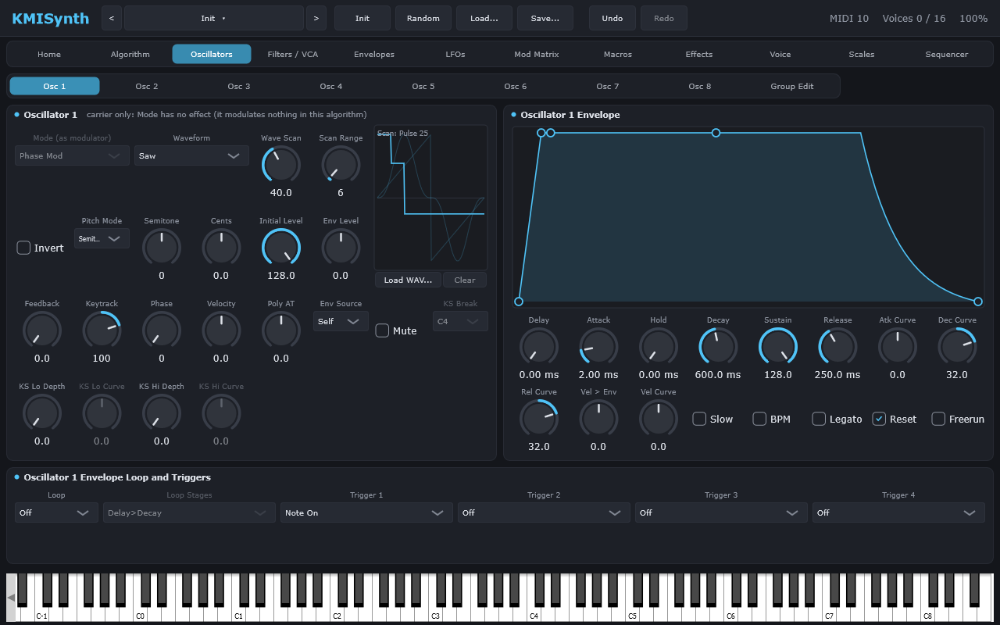
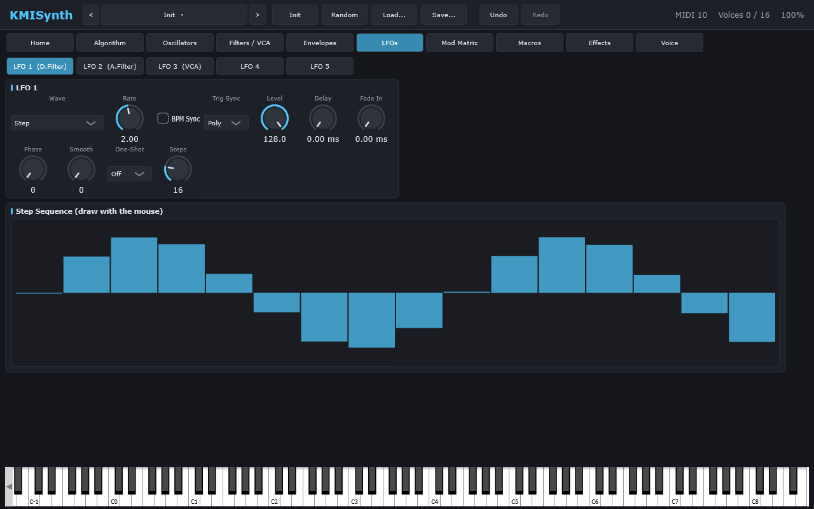
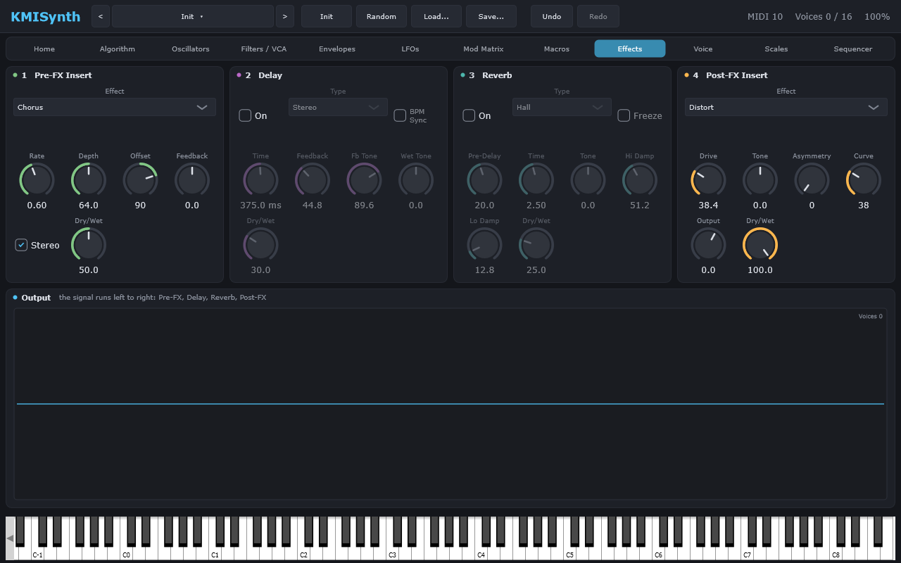
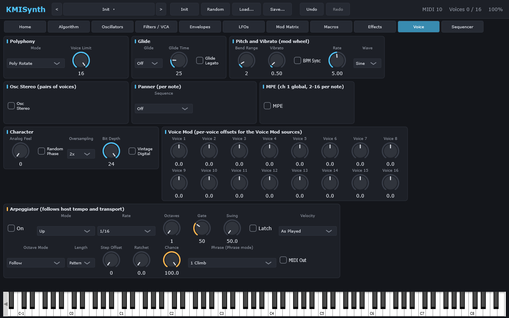
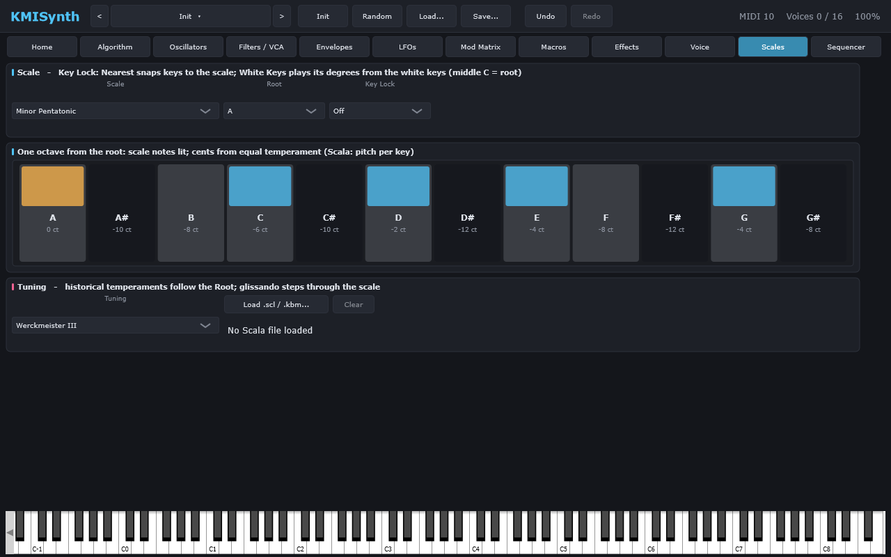
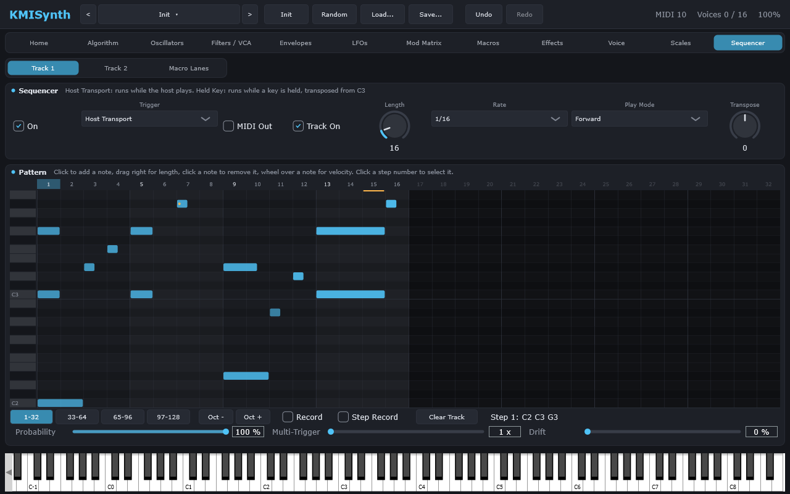
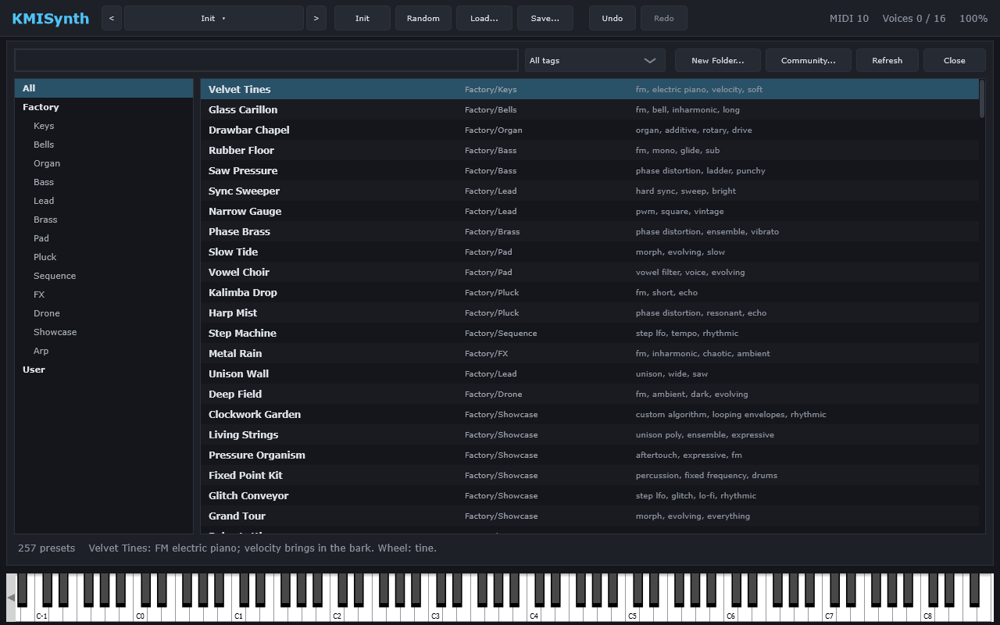

# KMISynth

A hybrid algorithmic polyphonic synthesizer (VST3, Windows). Its architecture follows the ASM Leviasynth: 8 multi-mode oscillators per voice, morphable algorithms, a digital multimode filter feeding a modelled analog 4-pole low-pass, and deep modulation. All content is original. See [docs/REQUIREMENTS.md](docs/REQUIREMENTS.md).



Every preset has an MP3 demo: see the Listen column in the [preset table](#status-phase-1-complete-engine-effects-custom-ui-phase-2-under-way).

<details>
<summary><b>More screenshots</b> (Algorithm, Oscillators, LFOs, Effects, Voice, Scales, Sequencer, preset browser)</summary>

**Algorithm:** the carrier/modulator diagram and the clickable 8×8 matrix.


**Oscillators:** the waveform panel shows Wave Scan's live crossfade; Load WAV fills the User slots.


**LFOs:** a Step LFO's sequence, drawn with the mouse.


**Effects:** numbered in signal order: Pre-FX insert, Delay, Reverb, Post-FX insert.


**Voice:** polyphony, glide, Osc Stereo, Panner, MPE, character, Voice Mod and the arpeggiator.


**Scales:** 44 scales plus Custom on any root, Key Lock, historical tunings and Scala files.


**Sequencer:** two polyphonic note tracks in a piano roll, plus 8 macro lanes; per-step probability, multi-trigger and drift.


**Preset browser:** search, tags and folders.


</details>

## Build

Prebuilt Windows and macOS packages are on the [Releases](https://github.com/KellyMurphy/KMISynth/releases) page. To build from source you need a C++20 compiler, CMake 3.25 or later, Git and an internet connection for the first configure, which fetches JUCE 8.0.15. A full build takes a few minutes.

```sh
git clone https://github.com/KellyMurphy/KMISynth.git
cd KMISynth
```

### Windows

Prerequisites:

- **Visual Studio 2022** (the free Community edition is fine) with the **Desktop development with C++** workload. Its bundled CMake is enough; the build script finds it.
- **Git**, for example `winget install Git.Git`.
- Optional: **Inno Setup 6** for the installer (`winget install JRSoftware.InnoSetup`), and **Python 3** to regenerate presets.

```powershell
.\scripts\build.ps1            # Release: VST3 + Standalone + tests
.\scripts\build.ps1 -Test      # build, then run the engine tests
.\scripts\build.ps1 -EngineOnly -Test   # DSP only, no JUCE (fast iteration)
```

Outputs are in `build\plugin\KMISynth_artefacts\Release\`:

- `VST3\KMISynth.vst3`: copy it to `C:\Program Files\Common Files\VST3` to load it in a DAW.
- `Standalone\KMISynth.exe`

#### Installer

```powershell
.\scripts\make-installer.ps1   # needs Inno Setup 6; writes build\installer\KMISynth-<version>-Windows-Setup.exe
```

The installer puts the VST3 bundle in `Common Files\VST3` and, optionally, the standalone app in `Program Files\KMISynth` with a Start-menu entry. It never touches your presets in `Documents\KMISynth`, including on uninstall.

### macOS

Prerequisites:

- **macOS 11** or later, on Apple Silicon or Intel.
- **Xcode** (from the App Store) or just the **Command Line Tools** (`xcode-select --install`). Either provides clang and Git. Xcode is also needed if you want an Xcode project.
- **CMake 3.25+**, for example `brew install cmake` with [Homebrew](https://brew.sh), or the installer from [cmake.org](https://cmake.org/download/).
- Optional: **Python 3** to regenerate presets, **ffmpeg** (`brew install ffmpeg`) for the MP3 demos.

```sh
cmake -S . -B build -DCMAKE_BUILD_TYPE=Release
cmake --build build --parallel
ctest --test-dir build --output-on-failure      # engine tests
```

This builds for your Mac's own architecture. For a universal (Apple Silicon + Intel) build like the release packages, add `-DCMAKE_OSX_ARCHITECTURES="arm64;x86_64" -DCMAKE_OSX_DEPLOYMENT_TARGET=11.0` to the first command. Use `-DKMI_BUILD_PLUGIN=OFF` for a fast engine-only build without JUCE. To work in Xcode instead, configure with `-G Xcode` and open `build/KMISynth.xcodeproj`.

Outputs are in `build/plugin/KMISynth_artefacts/Release/`:

- `AU/KMISynth.component`: copy it to `~/Library/Audio/Plug-Ins/Components` (Logic, GarageBand, MainStage and other AU hosts).
- `VST3/KMISynth.vst3`: copy it to `~/Library/Audio/Plug-Ins/VST3`.
- `Standalone/KMISynth.app`

If a host doesn't see a newly copied AU, run `killall -9 AudioComponentRegistrar` (or log out and in) and rescan. `auval -v aumu Kmis Kmii` checks that the AU loads. A plugin you build yourself isn't quarantined, so Gatekeeper doesn't block it.

### Continuous integration

`.github/workflows/ci.yml` runs on every push and pull request (Windows, VS 2022). It:

1. builds Release;
2. runs the engine tests through ctest;
3. validates the VST3 with pluginval at strictness 10;
4. builds the installer;
5. uploads the VST3, the installer and the pluginval logs as artifacts.

`.github/workflows/release.yml` builds the release packages: a universal macOS build (AU, VST3, Standalone; tests on both architectures, auval and pluginval) and the Windows installer and zip. Run it by hand from the Actions tab to test without publishing. Pushing a tag such as `v0.1.0-rc2` also creates a GitHub pre-release with the packages attached.

## Layout

| Path | What |
|---|---|
| `engine/` | Framework-agnostic C++20 DSP engine (`kmi::Engine`). No JUCE dependency. |
| `plugin/` | JUCE wrapper: parameters (`Parameters.cpp` is the single parameter description), MIDI and state. |
| `tests/` | Offline engine tests and a CPU benchmark (`kmi_engine_tests`, run by ctest). |
| `docs/` | Requirements. |

## Making a patch

KMISynth is an 8-oscillator FM / phase-modulation synth. Every sound is built from the same idea: some oscillators are
**carriers** (you hear them) and some are **modulators** (they reshape a carrier's waveform instead of being heard). The
**algorithm** decides which is which. This walkthrough builds a simple electric-piano-style patch and then shows where
to go from there.

### 1. Start from a blank patch

Click **Init** in the header. You get one sine on Osc 1, every filter open, and the **Eight Carriers** algorithm, where
all eight oscillators are carriers and nothing modulates anything. (That is also why an oscillator's **Mode** does
nothing in Init: Mode only matters for a modulator. The Osc page says so in the section title.)

### 2. Choose an algorithm

Open the **Algorithm** page and pick **One Pair** from *Preset Algorithm*. The diagram shows `2 > 1`: Osc 2 modulates
Osc 1, and Osc 1 is the carrier. Good starting algorithms:

| Algorithm | Use it for |
|---|---|
| One Pair | The simplest FM voice: one modulator on one carrier, six spare carriers for layers |
| Two Pairs, Four Free / Four Pairs | Two (or four) independent FM voices layered, e.g. a body and a bright attack |
| Stack Three, Five Free / Tall Tower | Modulators feeding modulators: brighter, more complex and harsher spectra |
| Many Into One | Several modulators on one carrier, each with its own ratio and envelope |
| Eight Carriers | Additive / layered sounds with no FM at all (drawbar organs, wavetable layers) |

You can also click cells in the 8×8 matrix to wire your own; the patch switches to **Custom**.

### 3. Set up the carrier

Open **Oscillators** > **Osc 1**. The section title confirms it is a carrier.

- **Waveform:** pick the base tone. Sine is the classic FM starting point; any of the 322 tables works (Saw, Reed, Choir,
  Bell Partials, or a frame of one of the Wavetables families...).
- **Initial Level:** how loud the carrier is (leave it near 128 for now).
- **Wave Scan / Scan Range:** set Scan Range to, say, 4 and turn Wave Scan: the oscillator crossfades from the
  selected wave through the next four in the Waveform menu. Route an LFO or envelope to it (right-click >
  Modulate with...) and the timbre moves on its own. The picture beside the knobs shows what is playing.
  For a smooth morph, pick frame 1 of a family under **Wavetables** in the menu (Pulse Width, Vowel Morph, FM Index...)
  and set Scan Range to 15: Wave Scan then sweeps the whole family.
- **Load WAV...:** load your own single-cycle WAV, or a wavetable WAV of 2048-sample frames (it fills several User
  slots and sets Scan Range to sweep them).

### 4. Add a modulator

Select **Osc 2**. The title now reads *modulates Osc 1 using Mode*.

- **Initial Level** on a modulator is the *modulation depth*. Raise it slowly from 0: the sine turns brighter and buzzier.
- **Pitch Mode > Ratio**, then **Ratio:** whole numbers (1, 2, 3, 4...) give harmonic, instrument-like tones. Ratios like
  3.5 or 7.13 give bells and metal. For an electric piano, try 1 for a soft body or 14 for a glassy tine.
- **Mode** sets *how* Osc 2 acts on Osc 1:
  - **Phase Mod** and **Freq Mod**: classic FM brightness.
  - **Hard Sync**: Osc 1's cycle restarts at Osc 2's rate, the tearing "sync sweep". Use a Saw carrier.
  - **PW Mod**, **PD Square**, **PD Saw**, **PD Saw-Pulse**: phase distortion, which bends the carrier's shape into
    pulse, saw or resonant-sounding forms.
- **Feedback:** the oscillator modulates itself, adding grit or noise at high settings.

### 5. Shape it over time

Real instruments get darker as they fade. Give the modulator its own envelope:

- On **Osc 2**, raise **Env Level** (for example 40) and set **Initial Level** lower (for example 10).
- In **Oscillator 2 Envelope** to the right, set **Attack** 0, **Decay** about 800 ms and **Sustain** 0. Each note now
  starts bright and mellows as the modulation dies away.
- **Vel > Env** (velocity to envelope) makes harder playing brighter, which is essential for keys and plucks.

The overall volume shape is the **VCA** envelope, **Env 3** on the **Envelopes** page (labelled *Env 3 (VCA)*). For a
piano-like decay: Attack 0, Decay 3000 ms, Sustain 0, Release 400 ms. For a pad: Attack 800 ms, Sustain at the top,
Release 2000 ms.

### 6. Filter (optional)

FM gets its brightness from the modulators, so many FM patches leave the filters open. For subtractive-style sounds (or
to tame a bright patch), use the **Filters / VCA** page:

- **Digital Filter** (driven by Env 1 and LFO 1): many types, including ladder, SVF morph and Vowel.
- **Analog Filter** (Env 2, LFO 2): a warm ladder with Pre-Drive.
- Lower **Cutoff**, add **Resonance**, then raise **Env 1 Amount** or **Env 2 Amount** for a filter sweep on every note.

### 7. Add movement

- **LFOs page:** set a rate (or BPM sync) and shape. LFO 1, 2 and 3 have dedicated depth knobs on the digital filter,
  analog filter and VCA (*LFO 1/2/3 Amount*).
- **Anything else:** right-click any knob and choose **Modulate with...** to route an LFO, envelope, velocity, mod wheel,
  aftertouch and so on to it. The route appears on the **Mod Matrix** page, and the knob gets an orange ring showing how far
  the modulation reaches. Classic example: a slow LFO on a modulator's level for a gently shifting timbre.
- **Voice page:** vibrato (mod wheel), glide, mono/unison, Osc Stereo, the Panner and the arpeggiator.

### 8. Effects

On the **Effects** page the signal runs **1 Pre-FX insert > 2 Delay > 3 Reverb > 4 Post-FX insert**. The inserts can
each hold a chorus, flanger, phaser, rotary, lo-fi, tremolo, EQ, compressor or distortion. A chorus in slot 1 is then
delayed and reverberated; in slot 4 it also colours the reverb tail. A typical keys patch: chorus in slot 1, a little
delay, a plate or hall reverb at 15-25% mix.

### 9. Macros and level

- **Macros page:** each of the 8 macros drives up to several destinations, each with its own depth. Give a patch two or
  three useful ones (Brightness, Attack, Space) so it can be tweaked from the Home page or automated in the DAW.
- **Patch Level** (Filters / VCA > VCA) sets the overall volume. Factory presets sit around -18 to -24 dB RMS; match
  that so your patches sit alongside them.

### 10. Save it

Click **Save...** and give it a name. User presets live in `Documents\KMISynth\Presets` (subfolders are fine) and appear
under **User** in the preset browser. Right-click a user preset there to add tags so search finds it.

### Community patches

Click **Community...** in the preset browser to download the community library from
[KMISynth-UserPatches](https://github.com/KellyMurphy/KMISynth-UserPatches) into `Documents\KMISynth\Presets\Community`.
The patches appear under **User > Community**. Click it again any time to get new and updated patches; files you add to
that folder yourself are kept. To share your own sounds, see that repository's README.

### Stuck for ideas?

Click **Random** in the header. With Amount around 20-30% it makes variations of the current sound; at 100% it
builds a new patch. Untick the parts you like (for example Envelopes and Effects) so they stay as they are, and use
**Undo** to step back. Save anything worth keeping.

### Learning from the factory presets

Each factory preset shows one technique (see the table below). Load one, then step through its Algorithm and
Oscillators pages: the section titles show which oscillators modulate which, and the orange rings show what is being
modulated. Good ones to study: **Velvet Tines** (two-pair electric piano), **Glass Carillon** (inharmonic bell ratios),
**Sync Sweeper** (Hard Sync), **Phase Brass** (phase distortion), **Wave Scanner** (layered wavetables) and **Grand
Tour** (everything at once).

## Status: Phase 1 complete (engine, effects, custom UI); Phase 2 under way

Done:

- **Voices:** 16 voices × 8 oscillators.
- **Oscillators:**
  - All 7 modulation modes: Phase Mod, Freq Mod, PW Mod, Hard Sync, PD Square/Saw/Saw-Pulse.
  - Semitone, Ratio and Frequency pitch modes.
  - Feedback, keytrack, phase, velocity and poly aftertouch.
  - Direct Out, mute.
  - 322 original band-limited wavetables, mip-mapped per octave:
    - 50 single waves in named groups (Basic, Shaped, Additive, Digital, Analog, FM).
    - 17 **wavetable families** of 16 frames each, made to be scanned: Pulse Width, Saw Bright, Square to Saw, Harmonic Build, Formant Sweep, Vowel Morph, FM Index, FM Octave, Hard Sync, Wavefold, Tube Drive, Phase Bend, Resonant Sweep, Crusher, Comb Sweep, Organ Stops and Spectra.
    - The picker has a submenu per group, each wave with a small picture of its shape. The whole bank is built with an FFT at startup in about 0.1 s.
  - **Wave Scan:** each oscillator crossfades from its selected wave through the next *Scan Range* waves (in menu order). Scan is a mod destination per oscillator and for all oscillators, so LFOs, envelopes, velocity or macros can sweep it. The Osc page draws the live crossfade.
  - **User wavetables:** 8 User slots per instance. Load a single-cycle WAV/AIFF/FLAC (up to 8192 samples, resampled to 2048) or a wavetable file of 2048-sample frames, which fills consecutive slots (up to 8 frames, evenly picked) ready to scan. User waves are band-limited like the built-in ones and saved in the session and in user presets; Init and factory presets clear them.
- **Algorithms:** 148 original preset algorithms (stacks, trees, fans, rings and feedback loops, ladders, sideband matrices, dense networks and instrument-shaped layouts), each a different shape (no two are relabelled copies of each other among the 84 added in Phase 2), Custom (8×8 matrix) and Morph across 8 slots. Direct Out adds any oscillator to the output on top of the selected algorithm.
- **Filters:** 18 digital filter types, the analog-model ladder with pre-drive, and gain staging (OSCs level, filter level, VCA level, patch level).
- **Envelopes:** 13 per voice, DAHDSR with curves, Fast/Slow, tempo sync, loops, and Legato/Reset/Freerun.
  - Up to 4 trigger sources each: Note On, LFO 1–5 cycle, Sustain pedal down, a MIDI CC crossing a threshold, and a Tap button on the Envelopes page.
  - An envelope without Note On waits for its other triggers. If that is the VCA envelope, the note stays silent until it is triggered.
- **LFOs:** 5, with Poly/Single/Free trigger, delay/fade, step mode, one-shot, smoothing and phase stagger. Plus a vibrato LFO.
- **Modulation:** 32-slot mod matrix (with modulation of route depths) and 8 macros with 8 routes each.
- **Voice modes:** Poly Rotate/Reassign, Mono, Mono Lo/Hi, Unison, Unison Lo/Hi, Unison Poly. Voice limit, glide and glissando, sustain pedal, analog drift.
- **Voice features:**
  - **Keyscale** per oscillator: a breakpoint, plus depth and curve (exp/lin/log) below and above it. Full depth reaches silence 4 octaves from the breakpoint.
  - **Osc Stereo:** each note plays on a left/right voice pair, which halves polyphony. Oscillator Pan (also a mod destination) applies to carriers, modulators or both, and Carrier Detune spreads the two sides by up to ±20 cents.
  - **Panner:** 15 stereo-position sequences plus Random. Each new note takes the next position. Width and Sequential/Reset mode are adjustable.
  - **Voice Mod:** 16 per-voice offsets that feed the Voice Mod and Voice Mod+ sources.
  - **Bit Depth:** 4–24 bits, applied before the filters.
  - **Vintage Digital:** raw (aliasing) wavetables read without interpolation, for an early-digital character.
- **Arpeggiator:**
  - Modes: Up, Down, Up/Down, Down/Up, Up&Down (both ends repeated), As Played, Random (no immediate repeats), Random Once (a shuffle that repeats until the chord changes), Chord and **Phrase**.
  - **Phrase** mode plays one of 64 original phrases over the held chord (chord tones, octave jumps, rests, ties, accents and chords within the phrase).
  - 1 to 6 octaves with an **Octave Mode**: Follow (the mode walks the whole range), Up, Down, Up/Down, Alt (each note through its octaves), Alt 2 (the octave changes every step) and Random.
  - **Length** (restart after 1-32 steps) and **Step Offset** (start further into the pattern).
  - **Ratchet** (a chance of repeating a step x2, x4 or x8 inside its length) and **Chance** (a chance that a step plays at all).
  - Any tempo division from 1/64T to 48 bars, gate 5–150% (over 100% notes overlap), swing 50–75%.
  - **MIDI Out** sends the arp's notes to the host, to record them or play other instruments.
  - Latch (a new chord replaces the latched one), the sustain pedal holds keys, and velocity can be as played or fixed.
  - Steps are sample accurate. While the host plays, they lock to its bar grid; a key pressed just after a grid line still catches that step. Otherwise the arp runs free from the first key.
  - Switching it on or off while holding keys hands them over cleanly.
- **Scales and tuning** (Scales page):
  - 44 scales (the church modes, harmonic and melodic minor, pentatonics, blues, symmetric, bebop, Hungarian, Neapolitan, Japanese and others, triads) plus a **Custom** scale of any notes, on any root.
  - **Key Lock:** Off; **Nearest** (keys snap to the closest scale note); or **White Keys** (the white keys play the scale's degrees in order, middle C = the root).
  - **Glissando** steps through the scale's notes.
  - **Tunings:** Equal, Just (5-limit), Pythagorean, Quarter-Comma Meantone, Werckmeister III, Kirnberger III and Vallotti, all on the scale's root.
  - **Scala files:** load a `.scl` scale (any number of notes per period, cents or ratios) with an optional `.kbm` keyboard mapping (a mapping with the same name is picked up automatically). Keys the mapping leaves out are silent. The files are saved with the patch.
  - The page shows one octave from the root: which notes are in the scale and each key's offset in cents.
- **Step sequencer** (Sequencer page):
  - Two polyphonic note tracks (up to 4 notes per step, each with velocity and a length from 1/4 step to 16 steps) and a macro track of 8 lanes that set Macros 1-8 step by step.
  - Up to 128 steps per track, each track with its own length, rate, play mode (Forward, Backward, Ping-Pong, Random), transpose and on/off.
  - Per step: probability, multi-trigger (1-4 hits inside the step) and drift (random lateness and velocity).
  - **Trigger:** Host Transport (locked to the host's bar grid while it plays) or Held Key (runs while a key is held, transposed by the key relative to C3).
  - **Recording:** real-time (notes go into the step that is playing) and step record (notes go into the selected step, then the cursor moves on; play a chord for a chord).
  - **MIDI Out** sends the sequence's notes to the host. The step data is saved with the patch.
- **Plugin:** 2× oversampling, sample-accurate MIDI, poly aftertouch, state save/load, undo/redo, `.kmip` preset files (XML).
- **MPE (lower zone):**
  - With **MPE** on (Voice page), channel 1 is global and channels 2–16 each carry one note.
  - A note's own pitch bend uses the **MPE Bend Range** (default 48 semitones).
  - Its channel pressure drives every Poly Aftertouch routing (oscillator levels, both filters, VCA, mod matrix) for that note only.
  - Its CC74 drives the new **Timbre** mod source. Outside MPE, CC74 drives Timbre for all notes.
  - Bends sent before a note-on apply to that note, and the same key held on two channels releases independently.
  - VST3 Note Expression is not supported yet. Hosts with MPE support send MPE instead.
- **MIDI learn:**
  - Right-click any knob, switch or choice and pick **MIDI Learn**, then move a controller (CC 0–119). Esc cancels.
  - Each parameter answers to one CC, and each CC drives one parameter; learning again moves the mapping.
  - Learned CCs still reach the mod matrix as CC sources.
  - Mappings are saved with the host session, not in presets, so changing presets keeps your controller layout. Remove them with **Forget MIDI CC** on the control, or with **Clear all MIDI mappings** in the preset menu.
  - The header shows the mapping count, and the knob menu shows the assigned CC.
- **Effects:** Pre-FX → Delay → Reverb → Post-FX.
  - Insert slots: Chorus, Flanger, Rotary, Phaser, Lo-Fi, Tremolo, EQ, Compressor (with tempo or note ducking), Distort.
  - Delay: Mono, Stereo, Ping-Pong, L-R-C, Reverse, with tempo sync.
  - Reverb: Hall, Plate, Room, Cloud, up to 90 s, with Freeze.
  - 16 FX mod-matrix destinations.
- **Custom UI:** scales from 75% to 200% with a fixed aspect ratio.
  - **Pages:** Home, Algorithm, Oscillators, Filters / VCA, Envelopes, LFOs, Mod Matrix, Macros, Effects, Voice.
  - **Algorithm page:** a live carrier/modulator diagram and a clickable 8×8 matrix. Editing switches the patch to Custom.
  - **Oscillators page:** single-oscillator editing, plus group edit (one parameter across all 8 oscillators, with their envelopes overlaid).
  - **Visual editors:** envelope drawings, a step-LFO editor (draw with the mouse), and an oscilloscope.
  - **Controls:**
    - Double-click resets a control. Ctrl-drag adjusts finely.
    - Right-click opens Reset, Copy/Paste and "Modulate with…", which adds a mod-matrix route.
    - Tooltips.
    - **Modulation rings:** a knob whose destination is routed in the mod matrix or a macro shows the reachable range as an orange outer arc. Bipolar sources (LFOs, pitch bend, Voice Mod, random) extend both ways. A dot follows the live modulated value of the newest voice.
  - **Voice page:** polyphony, glide, pitch/vibrato and the arpeggiator. The Home page has an Arp switch.
  - **Header:** preset name (opens the browser), previous/next factory preset, Init/Random/Load/Save, Undo/Redo, voice count.
  - **Randomiser (Random):** an Amount slider (low = variations of the current sound, 100% = a new patch) and switches for which parts may change: Algorithm, Oscillators, Envelopes, Filters, LFOs, Effects. It aims for playable results: carriers keep a level that suits the algorithm, modulators mostly get harmonic ratios, filters never close completely. Each press is one Undo step.
  - **Preset browser:**
    - Search matches name, folder, tags and description; every word must match.
    - A tag filter.
    - A folder tree: Factory and its categories, plus User with your own subfolders of `Documents\KMISynth\Presets`, and **New Folder**.
    - Double-click or Enter loads a preset and closes the browser. Esc closes it without loading.
    - Right-click a user preset to edit its tags (stored in the `.kmip` file), show it in Explorer, or delete it (to the Recycle Bin).
  - **Keyboard:** on-screen, for playing without a controller.
  - Pages show only the controls that apply. For example, an effects slot shows the selected type's parameters, and an oscillator shows pitch controls for its pitch mode.
- **Factory presets:** 256 original demo patches, each tagged for the browser, each with an MP3 demo (the Listen column). The first 16 each show one part of the engine, the six Showcase presets combine features, two Arp presets demonstrate the arpeggiator, and ten more show the voice features, new waves and MPE, eight show different ways to use the wavetables, and 78 more fill out every category (six each), several using Wave Scan. The last 136 (from Tine Ladder on) use the new algorithms, the wavetable families, the expanded arpeggiator and the step sequencer:

  | Preset | Category | Shows | Listen |
  |---|---|---|---|
  | Velvet Tines | Keys | Two FM pairs, velocity-scaled modulator envelopes, tremolo auto-pan | [▶ mp3](docs/audio/01-velvet-tines.mp3) |
  | Glass Carillon | Bells | Inharmonic ratios with partials that decay independently | [▶ mp3](docs/audio/02-glass-carillon.mp3) |
  | Drawbar Chapel | Organ | Eight Carriers as additive drawbars, key click, drive, rotary (wheel = fast) | [▶ mp3](docs/audio/03-drawbar-chapel.mp3) |
  | Rubber Floor | Bass | Three-operator stack with feedback, sub, mono legato glide, analog ladder | [▶ mp3](docs/audio/04-rubber-floor.mp3) |
  | Saw Pressure | Bass | PD Saw modulator that closes with its envelope | [▶ mp3](docs/audio/05-saw-pressure.mp3) |
  | Sync Sweeper | Lead | Hard Sync swept by envelope, LFO and mod wheel | [▶ mp3](docs/audio/06-sync-sweeper.mp3) |
  | Narrow Gauge | Lead | PW Mod pulse-width movement | [▶ mp3](docs/audio/07-narrow-gauge.mp3) |
  | Phase Brass | Brass | PD Saw ensemble, filter swell, delayed and faded LFO vibrato | [▶ mp3](docs/audio/08-phase-brass.mp3) |
  | Slow Tide | Pad | Algorithm Morph across four algorithms, driven by an LFO | [▶ mp3](docs/audio/09-slow-tide.mp3) |
  | Vowel Choir | Pad | Vowel filter swept by an LFO (wheel opens it) | [▶ mp3](docs/audio/10-vowel-choir.mp3) |
  | Kalimba Drop | Pluck | Short FM pluck with dotted echoes | [▶ mp3](docs/audio/11-kalimba-drop.mp3) |
  | Harp Mist | Pluck | Resonant PD pluck with ping-pong delay | [▶ mp3](docs/audio/12-harp-mist.mp3) |
  | Step Machine | Sequence | Tempo-synced step LFOs on the filter and FM depth (hold a note) | [▶ mp3](docs/audio/13-step-machine.mp3) |
  | Metal Rain | FX | Feedback ring of eight operators, S&H on modulator levels | [▶ mp3](docs/audio/14-metal-rain.mp3) |
  | Unison Wall | Lead | Six-voice detuned unison | [▶ mp3](docs/audio/15-unison-wall.mp3) |
  | Deep Field | Drone | Free-running LFOs on FM levels, long cloud reverb | [▶ mp3](docs/audio/16-deep-field.mp3) |
  | Clockwork Garden | Showcase | Custom algorithm with a feedback loop; looping tempo-synced envelopes tick 3 against 2; reverse delay | [▶ mp3](docs/audio/17-clockwork-garden.mp3) |
  | Living Strings | Showcase | Unison Poly ensemble; per-note random pan and tuning; staggered free LFOs; release velocity sets the tail | [▶ mp3](docs/audio/18-living-strings.mp3) |
  | Pressure Organism | Showcase | Expression: channel pressure and the wheel scale a random-FM route (depth of depth); poly pressure; key scaling | [▶ mp3](docs/audio/19-pressure-organism.mp3) |
  | Fixed Point Kit | Showcase | Percussion from fixed-frequency modulators, a Direct Out noise source, a pitch envelope and the low-pass gate | [▶ mp3](docs/audio/20-fixed-point-kit.mp3) |
  | Glitch Conveyor | Showcase | Step LFO that advances one step per note, S&H on warp and lo-fi, glissando, tempo-ducked compressor | [▶ mp3](docs/audio/21-glitch-conveyor.mp3) |
  | Grand Tour | Showcase | Everything at once (see below) | [▶ mp3](docs/audio/22-grand-tour.mp3) |
  | Pulse Lattice | Arp | Up/Down over two octaves in swung 16ths into a resonant ladder (hold a chord) | [▶ mp3](docs/audio/23-pulse-lattice.mp3) |
  | Glass Stairs | Arp | Random three-octave arpeggio of glassy FM through long echoes (hold a chord) | [▶ mp3](docs/audio/24-glass-stairs.mp3) |
  | Stereo Glass | Keys | Osc Stereo electric piano: body left, tine right, carrier detune | [▶ mp3](docs/audio/25-stereo-glass.mp3) |
  | Wide Reed | Lead | Reed wave on a stereo voice pair, delayed vibrato, legato glide | [▶ mp3](docs/audio/26-wide-reed.mp3) |
  | Bit Choir | Pad | Two choir waves at 10 bits, slowly trading places | [▶ mp3](docs/audio/27-bit-choir.mp3) |
  | Retro Bells | Bells | Vintage Digital FM bells with a keyscaled top end | [▶ mp3](docs/audio/28-retro-bells.mp3) |
  | Pan Pluck | Pluck | The Panner walks each new note across the stereo field | [▶ mp3](docs/audio/29-pan-pluck.mp3) |
  | Gated Pulse | Sequence | LFO 4 cycles retrigger the VCA envelope every 16th (hold a chord) | [▶ mp3](docs/audio/30-gated-pulse.mp3) |
  | Strata Strings | Pad | Voice Mod gives each of the 16 voices its own tuning and pan | [▶ mp3](docs/audio/31-strata-strings.mp3) |
  | Scaled Organ | Organ | Organ waves with keyscale, drive and rotary | [▶ mp3](docs/audio/32-scaled-organ.mp3) |
  | Fold Bass | Bass | Folded sine under a saw stack, mono legato | [▶ mp3](docs/audio/33-fold-bass.mp3) |
  | Pressure Glide | Lead | MPE: per-note bend, pressure and CC74 timbre (works on any keyboard) | [▶ mp3](docs/audio/34-pressure-glide.mp3) |
  | Wave Scanner | Pad | A wavetable scan built from layers: four tables cross-faded by two slow LFOs | [▶ mp3](docs/audio/35-wave-scanner.mp3) |
  | Partial Bloom | Pad | Additive tables (odd, even, prime, square partials) fading in one after another | [▶ mp3](docs/audio/36-partial-bloom.mp3) |
  | Formant Tines | Keys | Tables as modulators: Formant and Bell Partials phase-modulating sines | [▶ mp3](docs/audio/37-formant-tines.mp3) |
  | Table Sync | Lead | Hard sync through shaped tables (Sine Fold, Pulse Train) | [▶ mp3](docs/audio/38-table-sync.mp3) |
  | Stepped Arp | Arp | Stair tables read raw with Vintage Digital at 8 bits, arpeggiated | [▶ mp3](docs/audio/39-stepped-arp.mp3) |
  | Grain Field | Drone | Grain-table layers on random LFOs over a Pulse Train sub | [▶ mp3](docs/audio/40-grain-field.mp3) |
  | Skew Bass | Bass | A Skewed Sine carrier bent further by a PD Saw-Pulse modulator | [▶ mp3](docs/audio/41-skew-bass.mp3) |
  | Table Mallets | Pluck | Bump, Bell Partials and FM Hollow tables as body, strike and ring | [▶ mp3](docs/audio/42-table-mallets.mp3) |
  | Mellow Tines | Keys | A rounder tine piano: low FM index, long body, chorus. Macro 1: bark. | [▶ mp3](docs/audio/43-mellow-tines.mp3) |
  | Felt Hammer | Keys | Soft felted piano: triangle body, short high hammer partial. | [▶ mp3](docs/audio/44-felt-hammer.mp3) |
  | Hammer Clav | Keys | Percussive clav: PD Square bite through a resonant filter. | [▶ mp3](docs/audio/45-hammer-clav.mp3) |
  | Music Box | Keys | Inharmonic high partials, short tines and a long echo. | [▶ mp3](docs/audio/46-music-box.mp3) |
  | Reed Piano | Keys | Reed wave body, PW Mod bark, auto-pan tremolo. | [▶ mp3](docs/audio/47-reed-piano.mp3) |
  | Digital Grand | Keys | Three FM pairs with staggered decays and keyscaled top. | [▶ mp3](docs/audio/48-digital-grand.mp3) |
  | Temple Bowl | Bells | Struck bowl: two close partials beat slowly as it rings. | [▶ mp3](docs/audio/49-temple-bowl.mp3) |
  | Tubular Hall | Bells | Tubular bells with a strong 3.5 partial, long decay. | [▶ mp3](docs/audio/50-tubular-hall.mp3) |
  | Ice Chimes | Bells | Small glassy chimes with shimmering echoes. | [▶ mp3](docs/audio/51-ice-chimes.mp3) |
  | Toy Glock | Bells | Bright, short, a little out of tune. | [▶ mp3](docs/audio/52-toy-glock.mp3) |
  | Gamelan Gong | Bells | Deep gong; upper partials swell in after the hit. | [▶ mp3](docs/audio/53-gamelan-gong.mp3) |
  | Crystal Bloom | Bells | Wave Scan bell: its envelope scans from Bell Partials through the additive tables. | [▶ mp3](docs/audio/54-crystal-bloom.mp3) |
  | Jazz Drawbars | Organ | 16', 8', 4' and 2 2/3' drawbars; wheel: fast rotor. | [▶ mp3](docs/audio/55-jazz-drawbars.mp3) |
  | Cathedral Pipes | Organ | Full pipe organ with an octave below in a big hall. | [▶ mp3](docs/audio/56-cathedral-pipes.mp3) |
  | Reed Organ | Organ | Harmonium-like reeds, gently wavering. | [▶ mp3](docs/audio/57-reed-organ.mp3) |
  | Combo Organ | Organ | Buzzy square and pulse with vibrato. | [▶ mp3](docs/audio/58-combo-organ.mp3) |
  | Perc Organ | Organ | Decaying percussion click over steady drawbars, slow rotor. | [▶ mp3](docs/audio/59-perc-organ.mp3) |
  | Gospel Swell | Organ | Organ 8+4 with expression on the wheel, drive and rotary. | [▶ mp3](docs/audio/60-gospel-swell.mp3) |
  | Sub Thump | Bass | Sine sub with a short FM thump and pitch drop. | [▶ mp3](docs/audio/61-sub-thump.mp3) |
  | Acid Line | Bass | Saw through a resonant ladder, short envelope, legato glide. | [▶ mp3](docs/audio/62-acid-line.mp3) |
  | FM Pluck Bass | Bass | Plucked 1:1 FM with feedback and a sine sub. | [▶ mp3](docs/audio/63-fm-pluck-bass.mp3) |
  | Detuned Reese | Bass | Two detuned saws beating in unison, low-passed. | [▶ mp3](docs/audio/64-detuned-reese.mp3) |
  | Wood Bass | Bass | Upright-style: soft triangle, FM thunk, short release. | [▶ mp3](docs/audio/65-wood-bass.mp3) |
  | Growl Scan | Bass | A synced LFO scans the carrier through the Analog tables. | [▶ mp3](docs/audio/66-growl-scan.mp3) |
  | Square Hero | Lead | Classic square lead with delayed vibrato. | [▶ mp3](docs/audio/67-square-hero.mp3) |
  | Whistle | Lead | Pure sine whistle with breath and slow vibrato. | [▶ mp3](docs/audio/68-whistle.mp3) |
  | Feedback Scream | Lead | Self-modulating oscillator into drive. Macro 1: scream. | [▶ mp3](docs/audio/69-feedback-scream.mp3) |
  | Glide Saw | Lead | Every note slides; soft filter swell. | [▶ mp3](docs/audio/70-glide-saw.mp3) |
  | Vowel Lead | Lead | Talking lead: the vowel filter follows the wheel and an LFO. | [▶ mp3](docs/audio/71-vowel-lead.mp3) |
  | Pulse Ribbon | Lead | PW Mod movement on a stereo voice pair. | [▶ mp3](docs/audio/72-pulse-ribbon.mp3) |
  | Horn Section | Brass | Three detuned PD Saw voices with a blaring attack. | [▶ mp3](docs/audio/73-horn-section.mp3) |
  | Soft Horns | Brass | Rounded FM horns with a slow attack. | [▶ mp3](docs/audio/74-soft-horns.mp3) |
  | Brass Stab | Brass | Fast blare, quick decay, punchy. | [▶ mp3](docs/audio/75-brass-stab.mp3) |
  | Muted Horn | Brass | Band-passed, nasal and close. | [▶ mp3](docs/audio/76-muted-horn.mp3) |
  | Swell Brass | Brass | Synth brass that opens the longer you hold. | [▶ mp3](docs/audio/77-swell-brass.mp3) |
  | Low Brass | Brass | Tuba-like FM stack with a breathy attack, mono. | [▶ mp3](docs/audio/78-low-brass.mp3) |
  | Warm Blanket | Pad | Detuned soft saws, slow filter swell, chorus. | [▶ mp3](docs/audio/79-warm-blanket.mp3) |
  | Glass Horizon | Pad | The carrier slowly scans the additive tables on a free LFO. | [▶ mp3](docs/audio/80-glass-horizon.mp3) |
  | Ah Choir | Pad | Choir wave pad with vowel shimmer and ensemble. | [▶ mp3](docs/audio/81-ah-choir.mp3) |
  | Shimmer Veil | Pad | High FM partials swell into a long cloud reverb. | [▶ mp3](docs/audio/82-shimmer-veil.mp3) |
  | Dark Strings | Pad | Low-passed Strings wave with a slow bow. | [▶ mp3](docs/audio/83-dark-strings.mp3) |
  | Tide Scan | Pad | Two oscillators scan their own tables at different slow rates. | [▶ mp3](docs/audio/84-tide-scan.mp3) |
  | Silk Pluck | Pluck | Soft saw through a closing filter, dotted echoes. | [▶ mp3](docs/audio/85-silk-pluck.mp3) |
  | Nylon Pluck | Pluck | FM string pluck: fast pick, warm body. | [▶ mp3](docs/audio/86-nylon-pluck.mp3) |
  | Pizz Strings | Pluck | Short Strings-wave plucks in a hall. | [▶ mp3](docs/audio/87-pizz-strings.mp3) |
  | Marimba | Pluck | Bump body and a 4:1 mallet partial. | [▶ mp3](docs/audio/88-marimba.mp3) |
  | Digital Harp | Pluck | Bright PD pluck with long ringing tails. | [▶ mp3](docs/audio/89-digital-harp.mp3) |
  | Sync Pluck | Pluck | Hard-synced saw with a very short sweep. | [▶ mp3](docs/audio/90-sync-pluck.mp3) |
  | Trance Gate | Sequence | A square LFO chops the VCA into 16ths. Hold a chord. | [▶ mp3](docs/audio/91-trance-gate.mp3) |
  | Step Bassline | Sequence | A 16-step pitch pattern from one held note. | [▶ mp3](docs/audio/92-step-bassline.mp3) |
  | Poly Ticks | Sequence | Two looping envelopes tick 3 against 4. Hold a note. | [▶ mp3](docs/audio/93-poly-ticks.mp3) |
  | Step Chords | Sequence | A 16-step pattern plays the filter. Hold a chord. | [▶ mp3](docs/audio/94-step-chords.mp3) |
  | Random Blips | Sequence | Sample-and-hold pitch in 16ths, retriggering each step. | [▶ mp3](docs/audio/95-random-blips.mp3) |
  | Dotted Pulse | Sequence | The VCA retriggers every dotted 8th. Hold a chord. | [▶ mp3](docs/audio/96-dotted-pulse.mp3) |
  | Riser | FX | Pitch and filter climb for six seconds while held. | [▶ mp3](docs/audio/97-riser.mp3) |
  | Laser Zap | FX | Fast downward pitch sweep with FM grit. | [▶ mp3](docs/audio/98-laser-zap.mp3) |
  | Wind | FX | Feedback noise through a swept band-pass. | [▶ mp3](docs/audio/99-wind.mp3) |
  | Alarm | FX | A square LFO flips the pitch between two notes. | [▶ mp3](docs/audio/100-alarm.mp3) |
  | Underwater | FX | Muffled, wobbling low-pass with a slow phaser. | [▶ mp3](docs/audio/101-underwater.mp3) |
  | Glitch Bits | FX | 6-bit Vintage Digital; S&H on scan and pitch. | [▶ mp3](docs/audio/102-glitch-bits.mp3) |
  | Low Orbit | Drone | Sub octaves and slowly beating fifths. | [▶ mp3](docs/audio/103-low-orbit.mp3) |
  | Cathedral Hum | Drone | Organ and choir tables in a huge, slow hall. | [▶ mp3](docs/audio/104-cathedral-hum.mp3) |
  | Iron Hum | Drone | Inharmonic FM drone with feedback grit. | [▶ mp3](docs/audio/105-iron-hum.mp3) |
  | Night Choir | Drone | Choir tables crossfading on slow LFOs, 12 bits. | [▶ mp3](docs/audio/106-night-choir.mp3) |
  | Tidal Drone | Drone | One oscillator scans the whole Shaped group over half a minute. | [▶ mp3](docs/audio/107-tidal-drone.mp3) |
  | Beating Fifths | Drone | Two FM pairs a fifth apart, detuned to breathe. | [▶ mp3](docs/audio/108-beating-fifths.mp3) |
  | Scan Orchestra | Showcase | Four oscillators scan different table groups; velocity, LFOs and macros conduct. | [▶ mp3](docs/audio/109-scan-orchestra.mp3) |
  | Expressive Brass | Showcase | MPE brass: per-note bend, pressure opens and blares, CC74 brightens. | [▶ mp3](docs/audio/110-expressive-brass.mp3) |
  | Stereo Universe | Showcase | Osc Stereo, per-oscillator pan, the Panner and ping-pong delay together. | [▶ mp3](docs/audio/111-stereo-universe.mp3) |
  | Random Garden | Showcase | Per-note randomness on scan, tuning, pan and decay: no two notes alike. | [▶ mp3](docs/audio/112-random-garden.mp3) |
  | Morph Bells | Showcase | An envelope morphs the algorithm from a bell tree to a stack during each note. | [▶ mp3](docs/audio/113-morph-bells.mp3) |
  | Tempo Machine | Showcase | Arpeggiator, step-LFO filter pattern and synced delay together. Hold a chord. | [▶ mp3](docs/audio/114-tempo-machine.mp3) |
  | Rising Plucks | Arp | Up three octaves in 16ths. Hold a chord. | [▶ mp3](docs/audio/115-rising-plucks.mp3) |
  | Falling Bells | Arp | Down two octaves in triplet 8ths. Hold a chord. | [▶ mp3](docs/audio/116-falling-bells.mp3) |
  | Chord Stabs | Arp | Chord mode: the whole chord repeats in 8ths. Hold a chord. | [▶ mp3](docs/audio/117-chord-stabs.mp3) |
  | Played Order | Arp | Notes in the order played, swung. Hold a chord. | [▶ mp3](docs/audio/118-played-order.mp3) |
  | Octave Bass | Arp | Up/down bass arpeggio over two octaves. Hold a chord. | [▶ mp3](docs/audio/119-octave-bass.mp3) |
  | Swing Keys | Arp | Random electric-piano arpeggio with heavy swing. Hold a chord. | [▶ mp3](docs/audio/120-swing-keys.mp3) |
  | Tine Ladder | Keys | Electric Piano algorithm: a bright tine pair over a three-operator body. Macro 1: tine | [▶ mp3](docs/audio/121-tine-ladder.mp3) |
  | Funk Clav | Keys | Clav algorithm: two modulators bite a pulse; a second pair adds the pluck. Wheel: wah | [▶ mp3](docs/audio/122-funk-clav.mp3) |
  | Bark Reed | Keys | Square to Saw table reed piano: velocity scans toward the saw for a barking attack | [▶ mp3](docs/audio/123-bark-reed.mp3) |
  | Vowel Keys | Keys | Vowel Morph table piano: each note says a different vowel as it decays | [▶ mp3](docs/audio/124-vowel-keys.mp3) |
  | Glass Piano | Keys | Glass algorithm: three modulators shade one carrier; a second pair rings an octave up | [▶ mp3](docs/audio/125-glass-piano.mp3) |
  | Harmonic Upright | Keys | Harmonic Build table: each note starts with many harmonics and sheds them as it decays | [▶ mp3](docs/audio/126-harmonic-upright.mp3) |
  | Toy Upright | Keys | Pentagon algorithm: a small detuned toy piano with a woody knock | [▶ mp3](docs/audio/127-toy-upright.mp3) |
  | Ladder Harpsichord | Keys | Ladder algorithm: four plucked pairs, each feeding the next, for a bright jangle | [▶ mp3](docs/audio/128-ladder-harpsichord.mp3) |
  | Crushed Keys | Keys | Crusher table and a LoFi insert: a tired sampler piano. Macro 1: more crush | [▶ mp3](docs/audio/129-crushed-keys.mp3) |
  | Celesta Dust | Keys | Bell Ladder algorithm: a soft celesta with sparkling upper pairs and echoes | [▶ mp3](docs/audio/130-celesta-dust.mp3) |
  | Phased Tines | Keys | A classic tine piano through a slow phaser with gentle drive | [▶ mp3](docs/audio/131-phased-tines.mp3) |
  | Comb Piano | Keys | Comb Sweep table: notches drift through the tone as each note fades | [▶ mp3](docs/audio/132-comb-piano.mp3) |
  | Night Keys | Keys | Dark Saw Bright table through a soft low-pass, wide chorus and a long plate | [▶ mp3](docs/audio/133-night-keys.mp3) |
  | Gong Bloom | Bells | Gong algorithm: a deep crossed stack and a second struck group swell after the hit | [▶ mp3](docs/audio/134-gong-bloom.mp3) |
  | Chime Tree | Bells | Chimes algorithm: four bell voices at stretched ratios, scattered with ping-pong echoes | [▶ mp3](docs/audio/135-chime-tree.mp3) |
  | Gamelan Keys | Bells | Gamelan algorithm: two shared modulators ring two carriers a quarter-tone apart | [▶ mp3](docs/audio/136-gamelan-keys.mp3) |
  | Ladder Bells | Bells | Bell Ladder algorithm: three tuned bells, the upper ones feeding the lower | [▶ mp3](docs/audio/137-ladder-bells.mp3) |
  | Ring Bell | Bells | Ring of Three: three operators modulate each other in a loop for a wild, clanging bell | [▶ mp3](docs/audio/138-ring-bell.mp3) |
  | Spectral Bell | Bells | Spectra table bell: the strike scans through random partial sets as it rings | [▶ mp3](docs/audio/139-spectral-bell.mp3) |
  | Glass Harmonica | Bells | Bowed glass: slow attack, soft upper partials and a breathing tremolo | [▶ mp3](docs/audio/140-glass-harmonica.mp3) |
  | Steel Drum | Bells | A bright pan drum: short 1:2 FM with a pitch blip on the strike | [▶ mp3](docs/audio/141-steel-drum.mp3) |
  | Shimmer Bells | Bells | Soft bells into a frozen-sounding cloud reverb with octave echoes | [▶ mp3](docs/audio/142-shimmer-bells.mp3) |
  | Clock Tower | Bells | Tower, Every Other Heard: a deep tower bell whose middle partials sound too | [▶ mp3](docs/audio/143-clock-tower.mp3) |
  | Stop Changer | Organ | Organ Stops table: the wheel pulls out drawbar registrations one after another; rotary | [▶ mp3](docs/audio/144-stop-changer.mp3) |
  | Grit Organ | Organ | Organ With Two Mods: drawbar sines roughened by two FM operators and drive | [▶ mp3](docs/audio/145-grit-organ.mp3) |
  | Five Rank Pipes | Organ | Five Carriers, Three Mods: five pipe ranks, three of them with breathy FM edge | [▶ mp3](docs/audio/146-five-rank-pipes.mp3) |
  | Buzz Organ | Organ | Fan, All Heard: one operator buzzes all seven pipes and sounds itself | [▶ mp3](docs/audio/147-buzz-organ.mp3) |
  | Pipe Flute | Organ | A soft flute stop: low harmonics, a little breath on the attack | [▶ mp3](docs/audio/148-pipe-flute.mp3) |
  | Theatre Tremulant | Organ | Rounded tibia-style pipes with a deep tremulant and wide vibrato | [▶ mp3](docs/audio/149-theatre-tremulant.mp3) |
  | Chapel Reed | Organ | Reed stop: Square to Saw table with a nasal pair and a stone-church reverb | [▶ mp3](docs/audio/150-chapel-reed.mp3) |
  | Vowel Organ | Organ | Vowel Morph table pipes: a slow LFO makes the chord sing ah-eh-ee-oh-oo | [▶ mp3](docs/audio/151-vowel-organ.mp3) |
  | Rock Organ Drive | Organ | Full drawbars into a hot drive and a fast rotor. Wheel: slow/fast | [▶ mp3](docs/audio/152-rock-organ-drive.mp3) |
  | Calliope | Organ | A breathy steam-whistle organ: flutey sines with noise-like flutter and wide vibrato | [▶ mp3](docs/audio/153-calliope.mp3) |
  | Fork Bass | Bass | Bass Fork algorithm: a forked stack and a feedback pair punch a sine; mono glide | [▶ mp3](docs/audio/154-fork-bass.mp3) |
  | Stacked Punch | Bass | Bass Pair Stack: a four-high stack for the attack and a pair for the body | [▶ mp3](docs/audio/155-stacked-punch.mp3) |
  | Width Bass | Bass | Pulse Width table bass: an LFO sweeps the pulse width through a warm ladder | [▶ mp3](docs/audio/156-width-bass.mp3) |
  | Tube Bass | Bass | Tube Drive table: harder playing drives the wave toward a square | [▶ mp3](docs/audio/157-tube-bass.mp3) |
  | Table Acid | Bass | Resonant Sweep table: the envelope sweeps a baked-in resonant filter; accents with velocity | [▶ mp3](docs/audio/158-table-acid.mp3) |
  | Octave Growl | Bass | FM Octave table: the envelope scans from sine to a growling 2:1 FM | [▶ mp3](docs/audio/159-octave-growl.mp3) |
  | Fold Wobble | Bass | Wavefold table on a tempo LFO: the folds open and close in 8ths | [▶ mp3](docs/audio/160-fold-wobble.mp3) |
  | Sync Pluck Bass | Bass | Hard Sync table bass: each note bites with high sync and settles | [▶ mp3](docs/audio/161-sync-pluck-bass.mp3) |
  | Sub Pressure | Bass | A sine sub with a dark saw table on top, held together by a compressor | [▶ mp3](docs/audio/162-sub-pressure.mp3) |
  | Wide Reese | Bass | Mono unison saws, beating slowly, under a tight low-pass and phaser | [▶ mp3](docs/audio/163-wide-reese.mp3) |
  | Digital Thump | Bass | Long and Short algorithm: a long chain and a short stack hit one sine for a hard digital thump | [▶ mp3](docs/audio/164-digital-thump.mp3) |
  | Bent Bass | Bass | Phase Bend table: the envelope bends the phase for a resonant, talking bass | [▶ mp3](docs/audio/165-bent-bass.mp3) |
  | Twin Engine Lead | Lead | Sync Lead algorithm: a three-high stack and a three-into-one fan, mono with glide | [▶ mp3](docs/audio/166-twin-engine-lead.mp3) |
  | Breath Lead | Lead | Breathy Lead algorithm: a diamond of modulators with an airy noise layer; pressure: breath | [▶ mp3](docs/audio/167-breath-lead.mp3) |
  | Solo Stack | Lead | Lead Stack Plus Sub: a four-high stack sings over a sub and a pair; wheel opens it up | [▶ mp3](docs/audio/168-solo-stack.mp3) |
  | Formant Solo | Lead | Formant Sweep table: the wheel and pressure move the formant through the harmonics | [▶ mp3](docs/audio/169-formant-solo.mp3) |
  | Sync Table Lead | Lead | Hard Sync table on a slow LFO plus the envelope: the classic sweeping sync lead | [▶ mp3](docs/audio/170-sync-table-lead.mp3) |
  | Pressure Index | Lead | FM Index table: velocity and aftertouch raise the FM index for a brighter, harder tone | [▶ mp3](docs/audio/171-pressure-index.mp3) |
  | Thin Pulse Lead | Lead | Pulse Width table: a narrow, nasal pulse that slowly widens and narrows | [▶ mp3](docs/audio/172-thin-pulse-lead.mp3) |
  | Bent Phase Lead | Lead | Phase Bend table lead with a resonant sweep on every note; wheel bends further | [▶ mp3](docs/audio/173-bent-phase-lead.mp3) |
  | Chip Lead | Lead | Crusher table and 8-bit Vintage Digital: a chiptune square with fast vibrato and arpeggio glide | [▶ mp3](docs/audio/174-chip-lead.mp3) |
  | Folding Solo | Lead | Wavefold table lead: pressure and the wheel fold the sine into bright overtones | [▶ mp3](docs/audio/175-folding-solo.mp3) |
  | Scream Lead | Lead | Star Loop: one operator and three carriers modulate each other; turn it up for chaos | [▶ mp3](docs/audio/176-scream-lead.mp3) |
  | Whistle Lead | Lead | A pure whistled sine with long glide, delayed vibrato and a hall | [▶ mp3](docs/audio/177-whistle-lead.mp3) |
  | Stacked Brass | Brass | Brass Stack algorithm: three modulators open with the envelope like real lips | [▶ mp3](docs/audio/178-stacked-brass.mp3) |
  | Bright Horns | Brass | Saw Bright table horns: the brightness follows the envelope and velocity | [▶ mp3](docs/audio/179-bright-horns.mp3) |
  | Solo Trumpet | Brass | A mono trumpet: PD Saw bite on the attack, lip vibrato and short glide | [▶ mp3](docs/audio/180-solo-trumpet.mp3) |
  | Cup Mute Horn | Brass | A cup-muted horn: the Formant Sweep table held low, with a small wah on each note | [▶ mp3](docs/audio/181-cup-mute-horn.mp3) |
  | Soft Brass | Brass | A mellow unison brass pad with slow swells and gentle chorus | [▶ mp3](docs/audio/182-soft-brass.mp3) |
  | Tuba Weight | Brass | Tuba and trombone weight: a dark FM pair with a growl as it opens | [▶ mp3](docs/audio/183-tuba-weight.mp3) |
  | Stab Brass | Brass | A short, punchy synth-brass stab: unison saws through a snappy low-pass envelope | [▶ mp3](docs/audio/184-stab-brass.mp3) |
  | Brass Choir | Brass | Two Into Three algorithm: two shared modulators color three horns; three flutes support | [▶ mp3](docs/audio/185-brass-choir.mp3) |
  | Fanfare | Brass | Bright unison horns in a big hall, made for held chords | [▶ mp3](docs/audio/186-fanfare.mp3) |
  | Lattice Pad | Pad | Lattice algorithm: three tiers of modulators, the top ones drifting on slow LFOs | [▶ mp3](docs/audio/187-lattice-pad.mp3) |
  | Braided Strings | Pad | Braid algorithm: two string carriers woven from six crossing modulators | [▶ mp3](docs/audio/188-braided-strings.mp3) |
  | Section Strings | Pad | String Section algorithm: four voices, each pair sharing a bowing modulator | [▶ mp3](docs/audio/189-section-strings.mp3) |
  | Sideband Choir | Pad | Four By Four: four modulators feed four carriers, slowly trading places on free LFOs | [▶ mp3](docs/audio/190-sideband-choir.mp3) |
  | Choir Drift | Pad | Two Vowel Morph tables drift through the vowels at different rates; Unison Poly | [▶ mp3](docs/audio/191-choir-drift.mp3) |
  | Formant Dawn | Pad | Formant Sweep table: each chord rises slowly through its harmonics, like a sunrise | [▶ mp3](docs/audio/192-formant-dawn.mp3) |
  | Harmonic Sunrise | Pad | Harmonic Build table: harmonics arrive one by one as the chord is held | [▶ mp3](docs/audio/193-harmonic-sunrise.mp3) |
  | Comb Tides | Pad | Comb Sweep tables scanned by slow LFOs through a phaser: a moving, jet-like wash | [▶ mp3](docs/audio/194-comb-tides.mp3) |
  | Spectral Drift | Pad | Spectra table on a smoothed random LFO: shifting clouds of partials | [▶ mp3](docs/audio/195-spectral-drift.mp3) |
  | Pulse Strings | Pad | Two Pulse Width tables swept in opposite directions: a lush PWM string machine | [▶ mp3](docs/audio/196-pulse-strings.mp3) |
  | Hourglass | Pad | Hourglass algorithm: three modulators narrow to one, then widen again into the carrier | [▶ mp3](docs/audio/197-hourglass.mp3) |
  | Twin Webs | Pad | Two Webs algorithm: two small FM webs, each with two voices, panned in Osc Stereo | [▶ mp3](docs/audio/198-twin-webs.mp3) |
  | Mirror Pad | Pad | Mirrored Fans: three modulators into one carrier, one modulator into three | [▶ mp3](docs/audio/199-mirror-pad.mp3) |
  | Rewired Dusk | Pad | Algorithm morph across four of the new shapes: the pad slowly rewires itself | [▶ mp3](docs/audio/200-rewired-dusk.mp3) |
  | Six Ring Drone | Drone | Ring of Six: six operators modulate each other in a loop, slowly churning | [▶ mp3](docs/audio/201-six-ring-drone.mp3) |
  | Seven Ring Hum | Drone | Ring of Seven with a free sub: a deep hum with slowly beating operators | [▶ mp3](docs/audio/202-seven-ring-hum.mp3) |
  | Mesh Hum | Drone | Full Mesh Four: four operators all modulate each other; four sines hold it down | [▶ mp3](docs/audio/203-mesh-hum.mp3) |
  | Dense Undertow | Drone | Dense Six: six operators in a full cascade pull a low drone under the surface | [▶ mp3](docs/audio/204-dense-undertow.mp3) |
  | Fold Horizon | Drone | Wavefold table scanned by a slow LFO: the drone folds and unfolds over half a minute | [▶ mp3](docs/audio/205-fold-horizon.mp3) |
  | Valve Hum | Drone | Tube Drive table on a wandering random LFO: a warm, unstable amplifier hum | [▶ mp3](docs/audio/206-valve-hum.mp3) |
  | Overtone Chant | Drone | Vowel Morph and Formant Sweep tables: a held tone with whistling overtones moving above it | [▶ mp3](docs/audio/207-overtone-chant.mp3) |
  | Harmonium Haze | Drone | Organ Stops table drifting slowly through registrations, under a hazy cloud | [▶ mp3](docs/audio/208-harmonium-haze.mp3) |
  | Deep Tower | Drone | Skip Tower: a seven-high stack with shortcuts, its top operators slowly breathing | [▶ mp3](docs/audio/209-deep-tower.mp3) |
  | Rust Drone | Drone | Crusher table and a LoFi insert: a corroded, buzzing drone that slowly degrades | [▶ mp3](docs/audio/210-rust-drone.mp3) |
  | Kalimba Tines | Pluck | Kalimba algorithm: a doubly-struck carrier and three more tines at stretched ratios | [▶ mp3](docs/audio/211-kalimba-tines.mp3) |
  | Buzz Sitar | Pluck | A droning, buzzing pluck: Comb Sweep table bridge buzz and a sympathetic octave | [▶ mp3](docs/audio/212-buzz-sitar.mp3) |
  | Koto Pluck | Pluck | A bright koto-like string: a sharp FM pick and a fast pitch bend into the note | [▶ mp3](docs/audio/213-koto-pluck.mp3) |
  | Nylon Harp | Pluck | A soft harp: round triangle strings, gentle FM pluck and a long hall | [▶ mp3](docs/audio/214-nylon-harp.mp3) |
  | Nylon Guitar | Pluck | A plucked nylon string: saw and triangle through a closing low-pass, short body | [▶ mp3](docs/audio/215-nylon-guitar.mp3) |
  | Bright Banjo | Pluck | A twangy, metallic pick: Pulse Width table and a ringing, high modulator | [▶ mp3](docs/audio/216-bright-banjo.mp3) |
  | Sync Drop Pluck | Pluck | Hard Sync table: each pluck starts at high sync and drops to the fundamental | [▶ mp3](docs/audio/217-sync-drop-pluck.mp3) |
  | Bent Pluck | Pluck | Phase Bend table pluck: a resonant zap that closes as the note dies | [▶ mp3](docs/audio/218-bent-pluck.mp3) |
  | Talking Pluck | Pluck | Formant Sweep table pluck: every note says wow as it decays | [▶ mp3](docs/audio/219-talking-pluck.mp3) |
  | Crystal Pluck | Pluck | Glass algorithm at high ratios: a tiny, sparkling pluck with octave echoes | [▶ mp3](docs/audio/220-crystal-pluck.mp3) |
  | Cascade Pluck | Pluck | Cascade Into Pairs: one modulator strikes three pairs at once for a layered pluck | [▶ mp3](docs/audio/221-cascade-pluck.mp3) |
  | Upward Pluck | Pluck | Upward Pairs: the carriers modulate the operators above them, which are heard too | [▶ mp3](docs/audio/222-upward-pluck.mp3) |
  | Phrase Runner | Arp | Phrase mode arpeggio: a built-in melodic phrase played over the held chord. Hold a chord | [▶ mp3](docs/audio/223-phrase-runner.mp3) |
  | Ratchet Rain | Arp | Up arpeggio whose steps randomly ratchet into rolls of 2, 4 and 8. Hold a chord | [▶ mp3](docs/audio/224-ratchet-rain.mp3) |
  | Maybe Steps | Arp | Random-octave arpeggio where each step plays only 70% of the time. Hold a chord | [▶ mp3](docs/audio/225-maybe-steps.mp3) |
  | Leaping Octaves | Arp | Alternating octave mode: each note jumps between low and high octaves. Hold a chord | [▶ mp3](docs/audio/226-leaping-octaves.mp3) |
  | Mirror Arp | Arp | Up-and-down arpeggio that repeats the top and bottom notes, over two octaves. Hold a chord | [▶ mp3](docs/audio/227-mirror-arp.mp3) |
  | Shuffled Chord | Arp | Random Once: the chord is shuffled once and that order repeats until it changes. Hold a chord | [▶ mp3](docs/audio/228-shuffled-chord.mp3) |
  | Spectral Arp | Arp | Every arpeggio note lands on a random frame of the Spectra table. Hold a chord | [▶ mp3](docs/audio/229-spectral-arp.mp3) |
  | Overlap Arp | Arp | Gate over 100%: each arpeggio note rings into the next for a legato, padlike arp. Hold a chord | [▶ mp3](docs/audio/230-overlap-arp.mp3) |
  | Chord Hits | Arp | Chord mode: the whole held chord restruck in a tight 8th-note rhythm. Hold a chord | [▶ mp3](docs/audio/231-chord-hits.mp3) |
  | Key Bassline | Sequence | Step sequencer bassline started and transposed by the key you hold. Hold a note | [▶ mp3](docs/audio/232-key-bassline.mp3) |
  | Mallet Pattern | Sequence | A 12-step marimba pattern in 16ths from the step sequencer. Hold a note | [▶ mp3](docs/audio/233-mallet-pattern.mp3) |
  | Ratchet Line | Sequence | Sequencer line with ratcheted steps that roll in 3s and 4s. Hold a note | [▶ mp3](docs/audio/234-ratchet-line.mp3) |
  | Probable Pulse | Sequence | Sequencer pulses where each step has its own probability: it never repeats exactly. Hold a note | [▶ mp3](docs/audio/235-probable-pulse.mp3) |
  | Lane Filter Groove | Sequence | A macro lane steps the filter cutoff under a steady sequencer line. Hold a note | [▶ mp3](docs/audio/236-lane-filter-groove.mp3) |
  | Ping Pong Steps | Sequence | Sequencer in Ping-Pong mode: the pattern runs forward then back. Hold a note | [▶ mp3](docs/audio/237-ping-pong-steps.mp3) |
  | Chord Sequence | Sequence | Each sequencer step plays a chord: a four-bar progression from one held key. Hold a note | [▶ mp3](docs/audio/238-chord-sequence.mp3) |
  | Polymeter | Sequence | Two sequencer tracks of 5 and 7 steps drift against each other. Hold a note | [▶ mp3](docs/audio/239-polymeter.mp3) |
  | Loose Groove | Sequence | Sequencer drift: steps land a little late and vary in velocity, like a human. Hold a note | [▶ mp3](docs/audio/240-loose-groove.mp3) |
  | Table Sequence | Sequence | A macro lane walks the Harmonic Build table step by step under the sequence. Hold a note | [▶ mp3](docs/audio/241-table-sequence.mp3) |
  | Ring Siren | FX | Ring of Five with a slow pitch LFO: a wailing, metallic siren | [▶ mp3](docs/audio/242-ring-siren.mp3) |
  | Quad Ring Static | FX | Quad Ring: four pairs in a loop, with sample-and-hold on the feedback: radio static | [▶ mp3](docs/audio/243-quad-ring-static.mp3) |
  | Feedback Chatter | FX | Two-Way Chain: four operators pass modulation back and forth, chattering | [▶ mp3](docs/audio/244-feedback-chatter.mp3) |
  | Cross Talk | FX | Cross-Modulated Pairs: four pairs of carriers modulate each other: garbled voices | [▶ mp3](docs/audio/245-cross-talk.mp3) |
  | Fan Riser | FX | Feedback Fan: a looping fan of operators rising in pitch and brightness while held | [▶ mp3](docs/audio/246-fan-riser.mp3) |
  | Spinning Rings | FX | Ring Into Fan in Osc Stereo: a three-operator loop spins five carriers around the field | [▶ mp3](docs/audio/247-spinning-rings.mp3) |
  | Circuit Bend | FX | Carrier Cross: two carriers modulate each other while a stepped LFO bends the pitch | [▶ mp3](docs/audio/248-circuit-bend.mp3) |
  | Bit Sweep | FX | Crusher table swept downward while the pitch falls: a digital downlifter | [▶ mp3](docs/audio/249-bit-sweep.mp3) |
  | Data Stream | FX | Spectra table on sample-and-hold, in 16ths: a stream of computer chatter | [▶ mp3](docs/audio/250-data-stream.mp3) |
  | Tower Laser | FX | Tower Top Loop: a looping tower fired by a fast pitch drop: retro laser shots | [▶ mp3](docs/audio/251-tower-laser.mp3) |
  | Alarm Loop | FX | Loop Atop Pairs: a mutual pair strikes three pairs, gated by a square LFO: a klaxon | [▶ mp3](docs/audio/252-alarm-loop.mp3) |
  | Wavetable Tour | Showcase | Four families scanned four ways: velocity, an LFO, an envelope and pressure. Macros 1-8 steer them | [▶ mp3](docs/audio/253-wavetable-tour.mp3) |
  | Algorithm Gallery | Showcase | Morphs through eight of the new algorithm shapes in turn; Macro 1 moves through them by hand | [▶ mp3](docs/audio/254-algorithm-gallery.mp3) |
  | Sequenced Scales | Showcase | Step sequencer locked to A minor pentatonic in Werckmeister III; any key transposes in key | [▶ mp3](docs/audio/255-sequenced-scales.mp3) |
  | Living Tables | Showcase | Unison Poly with Voice Mod and per-note randomness on four family scans: every voice its own wave | [▶ mp3](docs/audio/256-living-tables.mp3) |

  **Grand Tour** uses the whole engine in one patch:
  - all 7 oscillator modes and all 3 pitch modes;
  - an algorithm morph across five algorithms that each voice drifts through;
  - both filters with envelopes, LFOs, keytracking and pressure;
  - a looping envelope, and an oscillator that follows a shared envelope;
  - all 5 LFOs (delayed and faded, step, S&H, staggered free-running);
  - depth-of-depth routes and FX destinations in the mod matrix;
  - Unison Poly with analog feel;
  - all 8 macros (Morph, Brightness, Motion, Space, Grit, Width, Snap, Echo);
  - the full Pre-FX > Delay > Reverb > Post-FX chain.

  A test checks that it still covers all of these.

  Every preset sets Macro 1 and Macro 2 to useful controls (for example Brightness, Sweep, Space). The bank is loudness-matched.
  The presets are defined in code (`engine/src/Presets.cpp`). The tests render each one and check it for clipping, silence and stuck tails.
- **Performance:**
  - The filter chains of four voices run together in SSE registers (`FilterBank4`, R-RT-6).
  - Scalar and SIMD paths share one templated implementation, and a test checks they match lane by lane.
  - The oscillators of the same four voices also run together (`Voice::renderOscBank`). Each voice first computes its modulation, envelopes, LFOs and VCA gain for the control block; the 8 oscillators then run for all four lanes at once, with masks for inactive oscillators and per-lane connection weights. A test checks it against the scalar reference kernel across every oscillator mode, custom back edges, per-voice morph, Osc Stereo, keyscale, bit depth and Vintage Digital. This cut 8-oscillator patches by about 30%.
  - A full patch (16 voices × 8 oscillators, 2× oversampling, all FX) uses about 14–15% of one core on a Ryzen 9 7940HS. The target is ≤ 25%.
  - Run `kmi_bench` for a per-configuration and per-component breakdown.

Next (Phase 2):

- VST3 Note Expression. JUCE's VST3 wrapper does not implement it, so it needs changes to JUCE itself. Until then, MPE (done) covers expressive controllers; Cubase, Bitwig and other hosts send MPE to VST3 plugins.


### Demo renders

`kmi_render` plays a short phrase through every factory preset and writes 24-bit WAVs, so you can hear the presets without a DAW. It also prints peak, RMS and tail levels:

```powershell
.\build\tests\Release\kmi_render.exe "$env:USERPROFILE\Music\KMISynth demos"
```

The third preset set (the last 136) is generated from the spec files in [scripts/presets3](scripts/presets3): edit a spec, then run `python scripts/presets3/gen.py`. `level.py` re-measures loudness with `kmi_render` and updates each preset's level.

The MP3s in [docs/audio](docs/audio), linked from the preset table above, are these renders. To regenerate them after changing a preset (needs ffmpeg, for example `winget install Gyan.FFmpeg`):

```powershell
.\scripts\make-audio-demos.ps1
```

### UI development aid

If `KMI_UI_SNAPSHOT_DIR` is set, the editor renders every page (plus a few non-default states) to PNG files in that folder. It also loads every factory preset through the plugin parameters and writes `presets-check.txt`, which confirms that each preset survives the round trip unchanged. It also writes `midi-check.txt`, which exercises MIDI learn (learn, relearn, cancel, session save/restore, preset changes) on a separate headless processor. Use it to review layout changes without clicking through the UI:

```powershell
$env:KMI_UI_SNAPSHOT_DIR = "$env:TEMP\kmi-snap"; .\build\plugin\KMISynth_artefacts\Release\Standalone\KMISynth.exe
```

Snapshot mode changes parameters for its second pass, so use it on a throwaway instance.

### Implementation notes / deviations from the requirements

- **LFO rate** uses one continuous 0–150 Hz range instead of separate Fast/Slow ranges.
- **Envelope Slow mode** stretches the time parameters, which show their Fast-mode value.
- **Envelope BPM sync** snaps each segment to the nearest note division, so there are no separate division parameters.
- **Oscillator evaluation order** is 8 → 1. A modulator with a higher number is read from the current sample. A modulator with a lower number (custom algorithms only) is read from the previous sample.
- **PW Mod / PD / Sync** use our own phase-warp formulation. The modulator's pitch sets how often the process happens per carrier cycle, and its level sets the amount.
- **Effects are global.** Their mod-matrix destinations take values from the most recently started voice, so per-voice sources such as poly LFOs behave as they would on a mono synth.
- **Unused modulators pause.** Envelopes and LFOs that nothing in the patch listens to are not ticked, which saves CPU. They resume from where they stopped if a route starts using them mid-note.
- **Compressor sidechain** offers Off, Tempo Duck and Note Duck. The hardware's CV and tap inputs don't apply to a plugin.
- **Global FX bypass** (R-FX-6) and the per-type FX preset templates (R-FX-5) are not done yet.

## License

KMISynth is licensed under the [GNU Affero General Public License v3.0](LICENSE). It is built on [JUCE](https://juce.com), which is used under its AGPLv3 licence.
